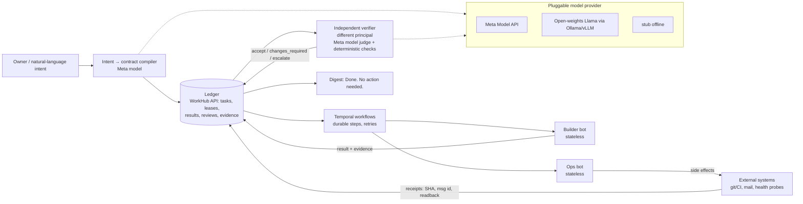

# Rouvr

**Rouvr. Make it happen.** Your pack, your ambition.

Rouvr is a reliable autonomous colleague: *think it through, agree the plan, get it moving*, with you in control. Website: [rouvr.ai](https://rouvr.ai).

[](https://github.com/Anxy/rouvr/actions/workflows/ci.yml)
[](LICENSE)


Delegate work, trust it to follow through, and progressively supervise less while remaining in control.

You give Rouvr a messy instruction, for example *"Get today's report, submit it to ABC, make sure XYZ is done, escalate to 123 if it fails, and email the stakeholders."* Rouvr turns it into **accountable execution**: recorded intent, an agreed execution contract, agents with defined authority, independent review, evidence, recovery on failure, and verified completion with receipts. Proven recurring work, once authorised, runs unprompted, and the daily update becomes exception-only: *"Done. No action needed."*

Rouvr starts with software development (Rouvr builds Rouvr). The ambition is business operations and everyday work.

> Built for the Meta Global AI Developer Hackathon (2026) with the Meta Model API and Muse Code. The WorkHub/AIX governance and orchestration layer provides the accountability. Meta models are the intended engine for the intent → contract compiler, the ops reasoning steps and the verifier/judge (via the pluggable provider below).

## The idea: "Done. No action needed."

Most agent frameworks trust the agent's final message. Rouvr doesn't:

- **Stateless, role-agnostic bots.** All state lives in the ledger (tasks, leases, results, reviews), not in a chat session. Any bot can take any role, and a crashed bot can be replaced mid-task.
- **Builder ≠ reviewer.** The principal that produced a result can never accept it. Review is a separate lease held by a different identity.
- **System-produced evidence.** Closeout needs receipts the system itself records: commit SHA and CI result, a provider message id plus a readback, health probes, figures re-queried from source. "I did it" doesn't close anything.
- **Fail closed.** A missing key, a stale lease or an unverifiable side effect parks the task and escalates it. It never silently succeeds.

### Demo flow

1. **Intent → contract.** A Meta model turns a messy instruction ("every morning compile yesterday's lane report, publish it, check the worker is healthy, escalate if anything fails") into a typed contract: steps, success criteria, side effects, stakeholders, escalation and expiry.
2. **Grant.** The owner approves the contract once, as a bounded autonomy policy.
3. **Execute.** Worker bots run the steps through durable Temporal workflows.
4. **Inject a failure.** (a) Kill the worker mid-step: it resumes with no duplicate side effect. (b) Have the mail provider return 200 without delivering: the verifier finds no message id or readback, so it retries via a fallback. (c) Revoke the model key: the task parks before claim and escalates.
5. **Independent verification.** A separate verifier principal (a Meta model as judge, plus deterministic checks) reads the output back and checks it against source data.
6. **Close with receipts.** The timeline shows each leg's principal, SHA, message id and verdict, then `done`.
7. **Day 2.** The scheduled run reports *"Done. No action needed."*

## Architecture



| Path | What it is |
|---|---|
| `core/` | The aix backend: intent → contract, task lifecycle, orchestrator, verifier. `core/backend/aix_core/` is the runtime, and the FastAPI service and Temporal workflows also live in `core/backend/`. The pluggable model provider is `core/backend/rouvr_models/`, `core/src/aix/` holds the lifecycle contracts, and `core/libs/hyeve_core/` is the vendored framework lib (MIT). |
| `lane/` | The generic lane machinery: the headless model adapter (`codex exec` / `claude -p`), lease and slot recovery, the reviewed-merge continuation, wake bridge, signed execution packets, and a stdlib ledger CLI |
| `workers/` | The Meta Model API worker (compile / narrate / judge, stub adapter), the Node SDK worker, and pointers to the Muse and Codex adapters |
| `ledger/` | A slim WorkHub-lite: SQL tables for tasks, contracts, evidence and receipts, plus a small FastAPI app. Uses Postgres or SQLite. |
| `demo/` | Compose (Postgres, Redis, Temporal + UI, ledger), the morning-report ops task, and failure-injection scripts |
| `cli/` | `python -m cli.rouvr_cli` (tasks / show / demo; the ledger client used by the R10 rehearsal), plus the VS Code chat extension. The user-facing launcher is `bin/rouvr` (stack + supervisor session); `rouvr/` is the self-contained delivery loop and imports nothing from `core/` or `lane/` |
| `docs/` | Short design notes |
| `web/` | The project website |

## Quickstart

Requires Python 3.12+. Docker is optional, for the full stack.

```bash
cp .env.example .env              # defaults to the offline stub model provider
make setup                         # creates .venv and installs requirements
make test-public                   # ledger, demo, lane, workers, cli, provider tests; no services needed
make demo                          # runs the morning-report task against a local SQLite ledger
demo/failure_injection/kill_midstep.sh      # also: silent_delivery.sh, revoked_key.sh
# full stack:
make up                            # demo/docker-compose.yml: Postgres, Redis, Temporal (+UI :8080), ledger :8221
set -a; . ./.env; set +a
make api                           # core FastAPI on :8000, docs at /docs
```

### Use a Meta model

```bash
# .env
ROUVR_MODEL_PROVIDER=meta
META_MODEL_API_KEY=<your key>    # only ever read from the environment
# or open weights, locally:
ROUVR_MODEL_PROVIDER=ollama
OLLAMA_MODEL=llama3.1
```

```python
# run from repo root with PYTHONPATH=.:core:core/src:core/libs (the Makefile sets this)
from backend.rouvr_models import get_provider
print(get_provider().chat([{"role": "user", "content": "Compile this instruction into a contract: ..."}]))
```

## Ecosystem: powered by Hyeve

As the site puts it, Rouvr draws its specialists "from Hyeve, the ecosystem of agents, models, services and connectors beneath it", and stays *model agnostic*.

Rouvr is built by [eBizneeds](https://www.ebizneeds.com) (bootstrapped; India and Australia) on its **Hyeve** platform. In production Rouvr relies on these Hyeve services:

| Service | Role for Rouvr | In this repo |
|---|---|---|
| **WorkHub** | Task, contract, lease, review and evidence ledger | `ledger/` WorkHub-lite (no auth/leases) + `ledger/stub_workhub/` |
| **Hyeve Agent SDK** | Worker runtime that bots use to claim and report work | `workers/` (Node SDK worker, Meta worker) |
| **Comm / Notification service** | Email and notification delivery with message ids for readback | local file outbox in `demo/` |
| **Auth service** | Identity, principals, tenancy (`Hyeve-Tenant`) | not shipped; tests needing it are excluded |
| **OpsBus** | Ops event bus for wakes and lane events | not shipped |
| **Integration service** | Model and tool integrations | pluggable provider in `core/backend/rouvr_models/` |
| **CodeIntel** | Code understanding for software tasks | not shipped |
| **Hyeve Core** | Shared framework library | vendored in `core/libs/hyeve_core/` (MIT) |

This repo ships **WorkHub-lite and stubs so it runs standalone**. See [docs/ecosystem.md](docs/ecosystem.md).

## Status and limitations (honest)

What's demonstrated (in the private development deployment):
- Autonomous task sequences in the governed dev lane, with separate build, review and closeout roles, ownership fencing, idempotent and version-checked updates, and approval bound to the exact revision.
- Example: a private lending-platform PR (borrower self-service case lifecycle) went through 3 rounds of independent review and passed 1,348 operations tests and 142 gateway tests. It merged at `ce30cdb`, and the closeout evidence is recorded in WorkHub.
- Recovery across the full build, review and closeout cycle is **still being qualified**.

What's in this repo, as published:
- The core runtime and the FastAPI service import cleanly with the vendored `libs/hyeve_core`.
- `make test-public` is green: the ledger, the demo (happy path, day 2, and all three injected failures), lane, workers, cli, and the provider.
- Most of the core backend tests pass (last local run: 3,996 passed, 472 failed, 42 skipped, 27 errors). The failures need the private WorkHub/Auth/OpsBus services, fixtures that weren't published, or a live Postgres. The private repo has a similar pre-existing failure set, so treat the full `core/backend/tests` run as **not green**.
- `demo/morning_report.py` runs the §4 flow locally: contract → claim → deliver → independent readback and figure check → receipts → `done`, and "Done. No action needed." on rerun. Delivery goes to a local file outbox, not real email. It uses the stub model unless `ROUVR_MODEL_PROVIDER` is set. This script doesn't use Temporal yet; its crash-resume comes from the ledger's idempotency keys.

Not yet proven from this repo:
- The full stack running under `docker compose` from a clean checkout.
- The hackathon demo end to end on the real stack (Temporal worker kill, real mail delivery and readback, Meta model as judge). Only the local simulation above runs today.
- Calls to the live Meta Model API from this code path.

Other limitations:
- Rouvr was formerly "AIX" on the "Hyeve" platform. Internal module names (`aix_core`, `hyeve_aix_service`, the `HYEVE_AIX_SERVICE_` env prefix) haven't been renamed, to avoid breaking imports.
- `ledger/` is a first-pass WorkHub-lite. It has no auth, principals, leases or multi-tenancy, and the core backend's WorkHub client doesn't speak its API yet. `ledger/stub_workhub/` is kept as a generic in-memory stand-in.
- `lane/` contains only the generic parts of the private lane. Two of its tests need the private canary controller and are skipped.
- This is dev software. The compose stack isn't hardened.

## Roadmap

From the website, still **planned** here (not in this repo yet): a *pack of specialists* working in parallel (research, create, build, verify, deliver, operate), a *shared understanding* you can inspect and revise, and actions *through your connected systems*.

Planned, not yet done: see [docs/roadmap.md](docs/roadmap.md). Highlights: full stack verified under `docker compose`, the demo against the live Meta Model API, Temporal-backed demo with real worker kill, real mail readback, auth and leases in WorkHub-lite.

## Documentation

[Architecture](docs/architecture.md) · [Concepts](docs/concepts.md) · [Ecosystem](docs/ecosystem.md) · [Configuration](docs/configuration.md) · [Demo](docs/demo.md) · [Models](docs/models.md) · [Roadmap](docs/roadmap.md) · [Changelog](CHANGELOG.md)

## Contributing

Issues and PRs are welcome; see [CONTRIBUTING.md](CONTRIBUTING.md), [CODE_OF_CONDUCT.md](CODE_OF_CONDUCT.md) and [SECURITY.md](SECURITY.md).

## License

MIT © 2026 Ankur Mishra. See [LICENSE](LICENSE).
