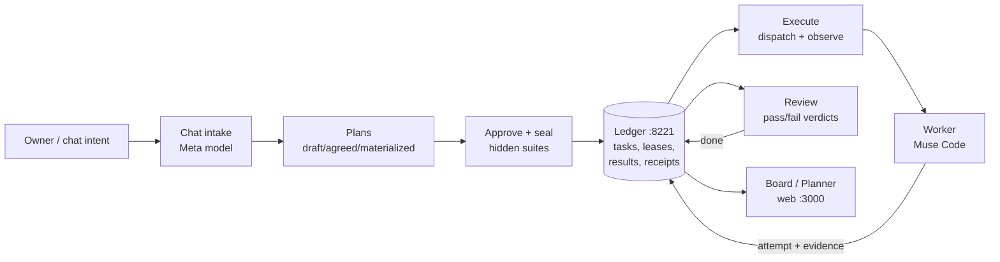

# Rouvr

**Rouvr. Make it happen.** Your pack, your ambition.

Rouvr is a reliable autonomous colleague: *think it through, agree the plan, get it moving*, with you in control. Website: [rouvr.ai](https://rouvr.ai).

[](https://github.com/Anxy/rouvr/actions/workflows/ci.yml)
[](LICENSE)


Delegate work, trust it to follow through, and progressively supervise less while remaining in control.

You give Rouvr a messy instruction, for example *"Get today's report, submit it to ABC, make sure XYZ is done, escalate to 123 if it fails, and email the stakeholders."* Rouvr turns it into **accountable execution**: recorded intent, an agreed execution contract, agents with defined authority, independent review, evidence, recovery on failure, and verified completion with receipts. Proven recurring work, once authorised, runs unprompted, and the daily update becomes exception-only: *"Done. No action needed."*

Rouvr starts with software development (Rouvr builds Rouvr). The ambition is business operations and everyday work.

> Built for the Meta Global AI Developer Hackathon (2026) with the Meta Model API and Muse Code. The WorkHub/AIX governance and orchestration layer provides the accountability. Meta models are the intended engine for the intent → contract compiler, the ops reasoning steps and the verifier/judge (via the pluggable provider below).

## The idea: "Done. No action needed."

Most agent frameworks trust the agent's final message. Rouvr doesn't:

- **Stateless, role-agnostic bots.** All state lives in the ledger (tasks, leases, results, reviews), not in a chat session. Any bot can take any role, and a crashed bot can be replaced mid-task.
- **Builder ≠ reviewer.** The principal that produced a result can never accept it. Done requires a passing verify result on the head plus a contract and evidence.
- **System-produced evidence.** Closeout needs receipts the system itself records: attempts, verdicts, evidence rows, seal receipts. "I did it" doesn't close anything.
- **Fail closed.** A missing key, a stale lease or an unverifiable side effect parks the task. It never silently succeeds.

### The loop

1. **Chat → plan.** You describe the work; the assistant asks one clarifying round when needed, then saves a plan knowledge entry and offers Convert / Edit / Keep.
2. **Planner → approve.** The plan thread shows its slice, tasks and criteria. Approve materializes one slice plus one task per step and authors a hidden acceptance suite per task (sealed, with durations in `seal:authored` receipts).
3. **Execute.** Dispatch assigns the chain to a worker; the execution view watches tasks move working → completed live, or says honestly that it is waiting for a worker.
4. **Verify.** Reviewer verdicts (pass/fail) move tasks to review and done; a failure returns the task to open for a fix round.

## Built during the hackathon (Oct 27 – Nov 4, 2026)

The repo opened Oct 27 as the Rouvr public cut and grew into the loop
above. What the week shipped, all verified live on ledger `:8221` + web
`:3000` with model `muse-spark-1.3-contributor`:

- Chat plan intake with an explicit plan-phrasing route, Saved badge and
  Convert/Edit/Keep offer (`tests/test_chat.py`).
- Plans endpoints: derived status (draft/agreed/materialized), idempotent
  approve, execute dispatch with worker assign + presence.
- Approve-time hidden-suite sealing with per-task durations
  (`tests/test_plans.py`: 6 passed).
- Task move/rename with tenant fencing, project archive, knowledge
  review/archive/pin, server paging.
- `make test-public`: 669 passed, 7 skipped. Web: `tsc` clean, lint 0
  errors, 99/99 guards. OpenAPI snapshot: 109 paths.
- End-to-end recordings under `e2e/recordings/`: chat→plan→approve→
  execute→fail→fix→done, with seal durations (28.3s, 29.8s) in receipts.

## Architecture



| Path | What it is |
|---|---|
| `ledger/` | WorkHub-lite: SQLite tasks, contracts, evidence, receipts, chat intake, plans, sealing — one FastAPI app (`ledger/app.py`), aliased under `/api/v1` by `ledger/lite.py`. |
| `web/` | The operator workspace (Next.js): board, chat, planner, execute view, tasks, projects, knowledge. Proxies the ledger same-origin. |
| `rouvr/` | MCP server, workhub client, hidden-suite writer used by sealing. |
| `core/`, `lane/`, `workers/`, `cli/`, `demo/` | The wider private-stack pieces (Temporal workflows, adapters, compose demo). Not needed for the lite loop. |
| `docs/` | Short design notes. `docs/r10-runs/` holds verification transcripts. |
| `e2e/` | Headless verification scripts; `e2e/recordings/` holds the loop recordings. |

## Quickstart (fresh clone)

Toolchains: Python 3.12+ and Node 22 + pnpm. Without a Meta key everything
below runs on the offline stub provider (chat plans and sealing need the
live model).

```bash
git clone https://github.com/Anxy/rouvr.git && cd rouvr
git checkout rouvr-development    # the active branch; main does not have this yet
make setup PY=python3.12         # project-local .venv + requirements.txt
```

Python must be 3.12 (`make setup` uses the system `python3`, which fails on
newer interpreters — tiktoken has no buildable wheel there). If `python3.12`
is missing, install it first; `uv` is not required.

Export the three lite secrets before anything else. The first process to
create `.rouvr/ledger.db` (even the test suite, which builds the app at
import) fixes the admin password, so later exports cannot change it:

```bash
export ROUVR_AUTH_SECRET=$(openssl rand -hex 32)
export ROUVR_LEDGER_TOKEN=$(openssl rand -hex 16)
export ROUVR_ADMIN_PASSWORD=<a strong password, 12+ chars>
make test-public                  # green (~7 min), no services needed
```

If sign-in ever fails with a fresh password, stop the ledger, `rm -rf .rouvr`,
and restart it with the exported values.

Run the ledger (terminal 1) with the values exported above:

```bash
make ledger                       # FastAPI on :8221, SQLite at .rouvr/ledger.db
```

Register the demo scope once (terminal 2):

```bash
curl -s -H "x-rouvr-token: $ROUVR_LEDGER_TOKEN" -H 'Content-Type: application/json' \
  -d '{"tenant":"demo"}' http://127.0.0.1:8221/v1/tenants
curl -s -H "x-rouvr-token: $ROUVR_LEDGER_TOKEN" -H 'Content-Type: application/json' \
  -d '{"tenant":"demo","project":"demo"}' http://127.0.0.1:8221/v1/projects
```

Run the web workspace (terminal 3):

```bash
cd web && pnpm install && pnpm build --webpack && pnpm start --port 3000
# open http://localhost:3000/workspace/login, sign in as admin
# with ROUVR_ADMIN_PASSWORD, then chat a plan, approve it in the
# planner, and watch it in the execute view
```

(`pnpm dev` also serves the pages, but judge with the production build
above — it is what the screenshots and recordings were made against.)

To use a Meta model instead of the stub (required for plan authoring and
sealing), export before starting the ledger:

```bash
export ROUVR_MODEL_PROVIDER=meta
export META_API_KEY=<your key> META_MODEL_API_BASE_URL=<model endpoint> META_MODEL_NAME=muse-spark-1.3
# or local open weights: ROUVR_MODEL_PROVIDER=ollama OLLAMA_MODEL=llama3.1
```

### Who runs what (agent roles → model → runtime)

| Role | Job | Model / tool | How it runs |
|---|---|---|---|
| Supervisor chat | One turn → plan offer or tasks (`POST /v1/chat`) | `muse-spark-1.3` via the **Meta Model API key**; stub when unset | Server-side in the ledger, streamed as SSE |
| Approver (you) | Planner Approve; seals hidden suites at approve time | Same model via the ledger | Approve button → `POST /v1/plans/{slug}/approve` |
| Coder / worker | Claim → attempt → result on a leased task | Headless `muse` CLI (Muse Code subscription) or `META_API_KEY` | Any host against the ledger; the execute view only observes |
| Reviewer | Pass/fail verdicts; done needs contract + evidence + passing head | No separate persona UI — verdicts are recorded via the API | Ledger receipts |

Neither credential is ever committed; both come from the environment.

## Ecosystem: powered by Hyeve

Rouvr draws its specialists "from Hyeve, the ecosystem of agents, models, services and connectors beneath it", and stays *model agnostic*.

Rouvr is built by [eBizneeds](https://www.ebizneeds.com) (bootstrapped; India and Australia) on its **Hyeve** platform. This repo ships the standalone lite cut — `ledger/` WorkHub-lite plus the web workspace — so it runs without the private Hyeve services. The wider pieces (`core/`, `lane/`, `workers/`, `cli/`, `demo/`) target the full stack. See [docs/ecosystem.md](docs/ecosystem.md).

## Status and limitations (honest)

What's green on this branch (`rouvr-development`):
- `make test-public`: 669 passed, 7 skipped (ledger, lite mapping, chat, plans, knowledge, tenant fencing; no Postgres/Temporal needed).
- Web: `tsc` clean, lint 0 errors, 99/99 component guards, OpenAPI snapshot (109 paths) in drift check.
- The plan loop, end to end on the live stack: chat → plan offer → approve (+ sealing, seal durations in receipts) → execute dispatch → fail → fix → done, recorded under `e2e/recordings/`.

Known limits, said plainly:
- **No separate reviewer persona.** Reviewer verdicts are recorded through the same API as everything else; there is no distinct reviewer UI or role. Builder≠reviewer holds as a rule (a passing verify result on the head plus contract and evidence gates `done`), not as a separate agent you can watch.
- **Sealing can fail closed and leave a task pending.** Approve-time sealing calls the model per task (bounded: 6,000 tokens, low reasoning, 90 s shared budget). A billing error or an unparseable suite records a `seal:authored` receipt with `ok: false` and `seal_pending` evidence instead of `suite_sealed`; `POST /v1/tasks/{id}/seal` retries it. Observed live: 28.3 s and 29.8 s seals, one 402, one unparseable retry.
- Chat plan authoring and sealing need the live Meta model; the stub provider answers but cannot author plans or suites.
- The MCP channel is supervisor-scoped: every MCP tool calls the ledger with the shared stack token and sees all tenants. Per-user scoping lives at the API layer.
- This is dev software. Nothing here is hardened.

## Roadmap

From the website, still **planned** here (not in this repo yet): a *pack of specialists* working in parallel (research, create, build, verify, deliver, operate), a *shared understanding* you can inspect and revise, and actions *through your connected systems*.

Planned, not yet done: see [docs/roadmap.md](docs/roadmap.md). Highlights: full stack verified under `docker compose`, the demo against the live Meta Model API, Temporal-backed demo with real worker kill, real mail readback, auth and leases in WorkHub-lite.

## Documentation

[Architecture](docs/architecture.md) · [Concepts](docs/concepts.md) · [Ecosystem](docs/ecosystem.md) · [Configuration](docs/configuration.md) · [Demo](docs/demo.md) · [Models](docs/models.md) · [Roadmap](docs/roadmap.md) · [Changelog](CHANGELOG.md)

## Contributing

Issues and PRs are welcome; see [CONTRIBUTING.md](CONTRIBUTING.md), [CODE_OF_CONDUCT.md](CODE_OF_CONDUCT.md) and [SECURITY.md](SECURITY.md).

## License

MIT © 2026 Ankur Mishra. See [LICENSE](LICENSE).
