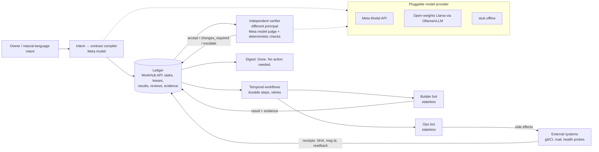

# Rouvr

**Rouvr. Make it happen.** Your pack, your ambition.

Rouvr is a reliable autonomous colleague: *think it through, agree the plan, get it moving*, with you in control. Website: [rouvr.ai](https://rouvr.ai).

[](https://github.com/Anxy/rouvr/actions/workflows/ci.yml)
[](LICENSE)


Delegate work, trust it to follow through, and progressively supervise less while remaining in control.

You give Rouvr a messy instruction, for example *"Get today's report, submit it to ABC, make sure XYZ is done, escalate to 123 if it fails, and email the stakeholders."* Rouvr turns it into **accountable execution**: recorded intent, an agreed execution contract, agents with defined authority, independent review, evidence, recovery on failure, and verified completion with receipts. Proven recurring work, once authorised, runs unprompted, and the daily update becomes exception-only: *"Done. No action needed."*

Rouvr starts with software development (Rouvr builds Rouvr). The ambition is business operations and everyday work.

> Built for the Meta Global AI Developer Hackathon (2026) with the Meta Model API and Muse Code. The WorkHub/AIX governance and orchestration layer provides the accountability. Meta models are the intended engine for the intent → contract compiler, the ops reasoning steps and the verifier/judge (via the pluggable provider below).

## The idea: "Done. No action needed."

Most agent frameworks trust the agent's final message. Rouvr doesn't:

- **Stateless, role-agnostic bots.** All state lives in the ledger (tasks, leases, results, reviews), not in a chat session. Any bot can take any role, and a crashed bot can be replaced mid-task.
- **Builder ≠ reviewer.** The principal that produced a result can never accept it. Review is a separate lease held by a different identity.
- **System-produced evidence.** Closeout needs receipts the system itself records: commit SHA and CI result, a provider message id plus a readback, health probes, figures re-queried from source. "I did it" doesn't close anything.
- **Fail closed.** A missing key, a stale lease or an unverifiable side effect parks the task and escalates it. It never silently succeeds.

### Demo flow

1. **Intent → contract.** A Meta model turns a messy instruction ("every morning compile yesterday's lane report, publish it, check the worker is healthy, escalate if anything fails") into a typed contract: steps, success criteria, side effects, stakeholders, escalation and expiry.
2. **Grant.** The owner approves the contract once, as a bounded autonomy policy.
3. **Execute.** Worker bots run the steps through durable Temporal workflows.
4. **Inject a failure.** (a) Kill the worker mid-step: it resumes with no duplicate side effect. (b) Have the mail provider return 200 without delivering: the verifier finds no message id or readback, so it retries via a fallback. (c) Revoke the model key: the task parks before claim and escalates.
5. **Independent verification.** A separate verifier principal (a Meta model as judge, plus deterministic checks) reads the output back and checks it against source data.
6. **Close with receipts.** The timeline shows each leg's principal, SHA, message id and verdict, then `done`.
7. **Day 2.** The scheduled run reports *"Done. No action needed."*

## Built during the hackathon

Two supervisor-chat moments, run against the live stack (ledger on `:8221`,
web workspace on `:3000`, model `muse-spark-1.3-contributor`):

**A — Self-description from live sources.** The supervisor never recites a
hand-written capability list. At startup `scripts/supervisor_context.py`
builds its context from live sources only: the capabilities manifest is the
actual `@mcp.tool` registry in `rouvr/mcp_server.py` (26 tools:
`workhub_*`, `knowledge_*`, `rouvr_start_task`, `rouvr_schedule(_ops)`),
plus the open-tasks summary, the skill catalogue (knowledge entries of kind
`skill`), and the top verified knowledge rules.

Recorded web-chat turns (admin, project `supervisor/slice-e-demo-probe`,
web `:3000` → ledger `:8221`): `who are you and what can you do` →
classification `chat` (0.99), badge `Logged`, `created: 0`, reply *"I am
an AI assistant. …"* (turns #1–2). Honest finding at the time: the reply
was generic — it named none of the 26 manifest tools — so chat-turn
self-description was ungrounded even though startup context was live.
Follow-up live run 2026-11-03 (turn #3, message `fr-self-001`,
classification `chat` 0.98, badge `Logged`, `created: 0`) closed the gap:
the reply is now *"I am the Rouvr supervisor for tenant 'supervisor',
project 'slice-e-demo-probe'. … Tools: workhub_create_tenant,
workhub_create_project, … rouvr_schedule_ops."* — all 26 live tool names.
The per-request identity block (`IDENTITY_MARKER` in `ledger/chat.py`,
built from the live `@mcp.tool` registry plus skill catalogue, open tasks
and verified rules) shipped after the mismatch. Verified live, not staged.

**C — Intake, offer, Convert.** Every turn is classified
(`chat`/`knowledge`/`task`/`ambiguous`, with confidence and category
recorded). A plan-shaped turn first saves an **unverified** plan knowledge
entry (`source` = turn message id) and asks, creating nothing yet: reply
`Shall I turn this into an actionable plan? It becomes {n} tasks:
{titles}.`, badge `Saved: plan-<slug>`, task count unchanged. Convert (the
button, or a plain `yes`/`convert` reply) confirms the entry, then creates
one slice task plus one task per step — each with its category, its
acceptance contract, and a `plan_slug` link back to the entry — and answers
with `Task #N` badges on every created reply. Contract:
`tests/test_chat_intake.py` (17 passed). The supervisor then starts each
task's pipeline separately with `rouvr_start_task`; Convert itself leaves
tasks open.

Slice-E live run 2026-11-03: the plan turn (`propose a plan for simple
auth`, message `fr-plan-001`) did **not** take the ask path — the model
classified it `task` (0.85, `feature`), and per contract
(`test_intake_task_plan_creates_first_then_pipeline`) a task-class plan
auto-converts even under ask-for-everything. Plan entry
`plan-simple-auth-plan` (`knowledge:1202@v1`, tags `plan,
turn-fr-plan-001`) was saved and immediately confirmed (`verified: 1`);
slice #153 plus head task #152 plus step tasks #154–157 were created
(`created: 6`, badge `Task #152`); every `chat:create` receipt names source
`fr-plan-001` and model `muse-spark-1.3-contributor`. One steering retry
toward the ask path produced only model errors, so the Convert offer shape
(badge `Saved: plan-<slug>`, zero tasks created) remains contract-verified
only — the live offer→Convert recording is still pending. Model flakiness
during the run: alternating HTTP 402 Payment Required and empty-200 turns
across repeated sends (the server retries empty turns 2× per call before
failing the turn).

Pipeline: the supervisor started each step task's workflow separately
(`rouvr-task-supervisor-154-2eb47c28f26c1607`,
`-155-e9aa8df82c054081`, `-156-e84849e2c98a33ec7`,
`-157-dd1061efd7f8a558`). All four fail-closed at assign within a minute:
claimed by `svc-sup-coder`, then `blocked` with `escalation` evidence
`escalate:attempt-1:E_CONTRACT` plus a `temporal_handoff` receipt. Root
cause, corroborated two ways (ledger evidence + filesystem): no exec spec
for the probe project and no hidden suite for chat-created tasks (suites
are sealed only by `workhub_create_task` via test_author). No coder
workspace, no muse session, no grant file and no test run happened; the
reviewer stage (skill `knowledge:1199@v1`) was never reached — there was no
diff to review. Head task #152 and slice #153 left `open`. No rework
rounds: the failure is deterministic infrastructure, identical for all
four — re-running would mint leases without a new signal.

## Architecture



| Path | What it is |
|---|---|
| `core/` | The aix backend: intent → contract, task lifecycle, orchestrator, verifier. `core/backend/aix_core/` is the runtime, and the FastAPI service and Temporal workflows also live in `core/backend/`. The pluggable model provider is `core/backend/rouvr_models/`, `core/src/aix/` holds the lifecycle contracts, and `core/libs/hyeve_core/` is the vendored framework lib (MIT). |
| `lane/` | The generic lane machinery: the headless model adapter (`codex exec` / `claude -p`), lease and slot recovery, the reviewed-merge continuation, wake bridge, signed execution packets, and a stdlib ledger CLI |
| `workers/` | The Meta Model API worker (compile / narrate / judge, stub adapter), the Node SDK worker, and pointers to the Muse and Codex adapters |
| `ledger/` | A slim WorkHub-lite: SQL tables for tasks, contracts, evidence and receipts, plus a small FastAPI app. Uses Postgres or SQLite. |
| `demo/` | Compose (Postgres, Redis, Temporal + UI, ledger), the morning-report ops task, and failure-injection scripts |
| `cli/` | `python -m cli.rouvr_cli` (tasks / show / demo; the ledger client used by the R10 rehearsal), plus the VS Code chat extension. The user-facing launcher is `bin/rouvr` (stack + supervisor session); `rouvr/` is the self-contained delivery loop and imports nothing from `core/` or `lane/` |
| `docs/` | Short design notes |
| `web/` | The project website |

## Quickstart (fresh clone)

Toolchains: Python 3.12+ and Node 22 + pnpm. The only external secret is the
Meta key, read from the environment (never committed). Without it everything
below runs on the offline stub provider.

```bash
git clone https://github.com/Anxy/rouvr.git && cd rouvr
git checkout rouvr-development    # the active branch; main does not have this yet
make setup                       # .venv + requirements.txt
```

Pick the stack token and admin password next — export them before anything
else. The first process to create `.rouvr/ledger.db` (even the test suite,
which builds the app at import) fixes the admin password, so later exports
cannot change it:

```bash
export ROUVR_LEDGER_TOKEN=$(openssl rand -hex 16)
export ROUVR_ADMIN_PASSWORD=<a strong password, 12+ chars>
make test-public                  # green, no services needed
```

If sign-in ever fails with a fresh password, stop the ledger, `rm -rf .rouvr`,
and restart it with the exported values.

Run the ledger (terminal 1) with the values exported above:

```bash
make ledger                       # FastAPI on :8221, SQLite at .rouvr/ledger.db
```

If `make setup` fails creating the venv (system python without pip wheels),
use uv instead — verified with Python 3.12:

```bash
uv venv --python 3.12 .venv && uv pip install --python .venv/bin/python -r requirements.txt
```

Register the demo scope once (terminal 2):

```bash
curl -s -H "x-rouvr-token: $ROUVR_LEDGER_TOKEN" -H 'Content-Type: application/json' \
  -d '{"tenant":"demo"}' http://127.0.0.1:8221/v1/tenants
curl -s -H "x-rouvr-token: $ROUVR_LEDGER_TOKEN" -H 'Content-Type: application/json' \
  -d '{"tenant":"demo","project":"demo"}' http://127.0.0.1:8221/v1/projects
```

Run the web workspace (terminal 3):

```bash
cd web && pnpm install && pnpm dev --port 3000
# open http://localhost:3000/workspace/login, sign in as admin
# with ROUVR_ADMIN_PASSWORD, then use the board, chat and task pages
```

Omitting `ROUVR_ADMIN_PASSWORD` seeds a random one, printed once to the
ledger's terminal (never to logs). To use a Meta model instead of the stub:

```bash
export ROUVR_MODEL_PROVIDER=meta
export META_API_KEY=<your key> META_MODEL_API_BASE_URL=<model endpoint> META_MODEL_NAME=muse-spark-1.3
# or local open weights: ROUVR_MODEL_PROVIDER=ollama OLLAMA_MODEL=llama3.1
```

### Who runs what (agent roles → model → runtime)

| Role | Job | Model / tool | How it runs |
|---|---|---|---|
| Supervisor chat | One turn → slice with tasks, inline cards (`POST /v1/chat`) | `muse-spark-1.3` (default) via the **Meta Model API key**; stub when unset | Server-side in the ledger, streamed as SSE |
| Coder / worker | Claim → attempt → result on a leased task | Headless `muse` CLI (`MUSE_BIN`) | May run on the **Muse Code subscription (OAuth)** when the launcher host has it, otherwise on `META_API_KEY`; headless adapters for other CLIs live in `lane/` |
| Reviewer / judge | Compile, narrate, judge (`workers/meta_worker`) | Meta Model API key via the pluggable provider; stub when unset | Worker process against the ledger |
| Verifier | Deterministic checks (contracts, readbacks, figures) | No model | Ledger receipts + workflow assertions |
| Owner (you) | Board, chat, approve verified work, retry failures | Web workspace session (cookie + CSRF) | Browser → same-origin proxy → ledger |

Coder turns and supervisor turns deliberately use different credentials:
subscription OAuth (or a host key) executes code, while the Model API key only
ever sees prompt text for supervised turns. Neither is ever committed; both
come from the environment.

## Ecosystem: powered by Hyeve

As the site puts it, Rouvr draws its specialists "from Hyeve, the ecosystem of agents, models, services and connectors beneath it", and stays *model agnostic*.

Rouvr is built by [eBizneeds](https://www.ebizneeds.com) (bootstrapped; India and Australia) on its **Hyeve** platform. In production Rouvr relies on these Hyeve services:

| Service | Role for Rouvr | In this repo |
|---|---|---|
| **WorkHub** | Task, contract, lease, review and evidence ledger | `ledger/` WorkHub-lite (no auth/leases) + `ledger/stub_workhub/` |
| **Hyeve Agent SDK** | Worker runtime that bots use to claim and report work | `workers/` (Node SDK worker, Meta worker) |
| **Comm / Notification service** | Email and notification delivery with message ids for readback | local file outbox in `demo/` |
| **Auth service** | Identity, principals, tenancy (`Hyeve-Tenant`) | not shipped; tests needing it are excluded |
| **OpsBus** | Ops event bus for wakes and lane events | not shipped |
| **Integration service** | Model and tool integrations | pluggable provider in `core/backend/rouvr_models/` |
| **CodeIntel** | Code understanding for software tasks | not shipped |
| **Hyeve Core** | Shared framework library | vendored in `core/libs/hyeve_core/` (MIT) |

This repo ships **WorkHub-lite and stubs so it runs standalone**. See [docs/ecosystem.md](docs/ecosystem.md).

## Status and limitations (honest)

What's demonstrated (in the private development deployment):
- Autonomous task sequences in the governed dev lane, with separate build, review and closeout roles, ownership fencing, idempotent and version-checked updates, and approval bound to the exact revision.
- Example: a private lending-platform PR (borrower self-service case lifecycle) went through 3 rounds of independent review and passed 1,348 operations tests and 142 gateway tests. It merged at `ce30cdb`, and the closeout evidence is recorded in WorkHub.
- Recovery across the full build, review and closeout cycle is **still being qualified**.

What's in this repo, as published:
- The core runtime and the FastAPI service import cleanly with the vendored `libs/hyeve_core`.
- `make test-public` is green: the ledger, the demo (happy path, day 2, and all three injected failures), lane, workers, cli, and the provider.
- Most of the core backend tests pass (last local run: 3,996 passed, 472 failed, 42 skipped, 27 errors). The failures need the private WorkHub/Auth/OpsBus services, fixtures that weren't published, or a live Postgres. The private repo has a similar pre-existing failure set, so treat the full `core/backend/tests` run as **not green**.
- `demo/morning_report.py` runs the §4 flow locally: contract → claim → deliver → independent readback and figure check → receipts → `done`, and "Done. No action needed." on rerun. Delivery goes to a local file outbox, not real email. It uses the stub model unless `ROUVR_MODEL_PROVIDER` is set. The same flow also runs as `OpsTaskWorkflow` under Temporal (S018, covered by `tests/test_ops.py::test_ops_workflow_done_digest`); the standalone script's own crash-resume comes from the ledger's idempotency keys.

Not yet proven from this repo:
- The hackathon demo end to end on the real stack (Temporal worker kill, real mail delivery and readback, Meta model as judge). Only the local simulation above runs today. (The supervisor stack itself — Temporal, ledger, workers, MCP — was verified from a clean checkout on 2026-11-01 via `make setup PY=python3.12` then `./scripts/rouvr --no-chat`, including a ledger tenant/project/task smoke and a clean teardown.)
- Calls to the live Meta Model API from this code path.

Other limitations:
- Rouvr was formerly "AIX" on the "Hyeve" platform. Internal module names (`aix_core`, `hyeve_aix_service`, the `HYEVE_AIX_SERVICE_` env prefix) haven't been renamed, to avoid breaking imports.
- `ledger/` is WorkHub-lite with token auth on local ports (shared stack token plus per-user tokens, S011/S016), leases, and mandatory tenant/project partitions (S022). The core backend's WorkHub client still speaks the private `/api/v1` + `/api/workhub` API, not this ledger's `/v1` API. `ledger/stub_workhub/` is kept as a generic in-memory stand-in.
- The MCP channel is supervisor-scoped: every MCP tool calls the ledger with the shared stack token and sees all tenants. Per-user scoping (tenant partitions, restricted/company/public visibility) lives at the API layer — enforced on every ledger endpoint and reachable with per-user tokens or Hyeve JWTs, but not through MCP tool calls.
- `lane/` contains only the generic parts of the private lane. Two of its tests need the private canary controller and are skipped.
- This is dev software. The compose stack isn't hardened.

## Roadmap

From the website, still **planned** here (not in this repo yet): a *pack of specialists* working in parallel (research, create, build, verify, deliver, operate), a *shared understanding* you can inspect and revise, and actions *through your connected systems*.

Planned, not yet done: see [docs/roadmap.md](docs/roadmap.md). Highlights: full stack verified under `docker compose`, the demo against the live Meta Model API, Temporal-backed demo with real worker kill, real mail readback, auth and leases in WorkHub-lite.

## Documentation

[Architecture](docs/architecture.md) · [Concepts](docs/concepts.md) · [Ecosystem](docs/ecosystem.md) · [Configuration](docs/configuration.md) · [Demo](docs/demo.md) · [Models](docs/models.md) · [Roadmap](docs/roadmap.md) · [Changelog](CHANGELOG.md)

## Contributing

Issues and PRs are welcome; see [CONTRIBUTING.md](CONTRIBUTING.md), [CODE_OF_CONDUCT.md](CODE_OF_CONDUCT.md) and [SECURITY.md](SECURITY.md).

## License

MIT © 2026 Ankur Mishra. See [LICENSE](LICENSE).
