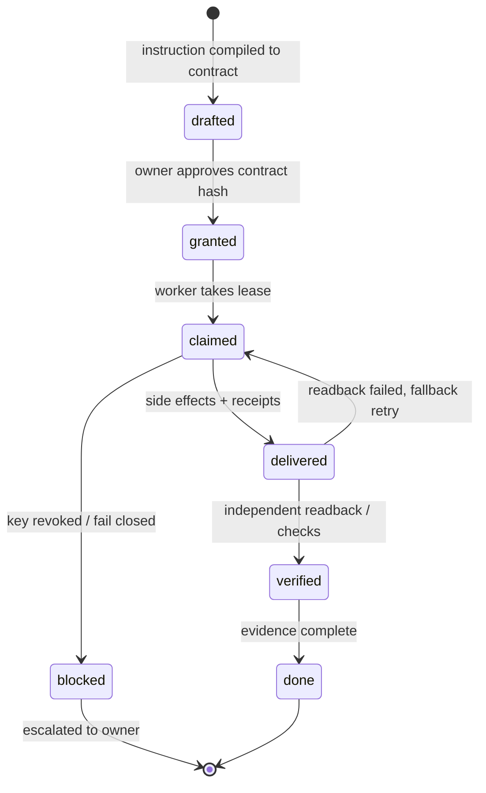

# Architecture

Rouvr turns a natural-language instruction into a typed execution contract, runs it with stateless workers, and closes the task only when an independent verifier has checked durable evidence.

1. **Intent → contract** (`core/`, `workers/meta_worker`). A model, the Meta Model API by default, compiles the instruction into steps, success criteria, side effects, escalation and an expiry. The contract is stored in the ledger and hashed.
2. **Ledger** (`ledger/`). The source of truth: tasks, contracts, evidence and receipts. Every state change carries an idempotency key, so a replay returns the original receipt instead of acting twice. `done` is refused without a contract and evidence.
3. **Execution** (`core/backend/workflows`, `lane/`, `workers/`). Temporal provides durable steps. The lane handles leases, slot recovery, wake-ups and headless model runs.
4. **Verification**. A separate principal reads back side effects (for example, the delivered message), rechecks figures against the ledger, and probes health. Only then does the task move to `done`.
5. **Digest**. Repeat runs that find nothing to do report "Done. No action needed."

## Lifecycle

## Components
- **Intent compiler** (`core/`, `workers/`): instruction → typed contract via the pluggable model provider.
- **Ledger** (`ledger/`, WorkHub in production): single source of truth; bots are stateless.
- **Workers** (`workers/`, `lane/`): execute steps, record receipts with idempotency keys.
- **Verifier**: separate principal; deterministic checks plus optional model judge.
- **Digest**: exception-only daily report.

See [concepts.md](concepts.md) and [ecosystem.md](ecosystem.md).
